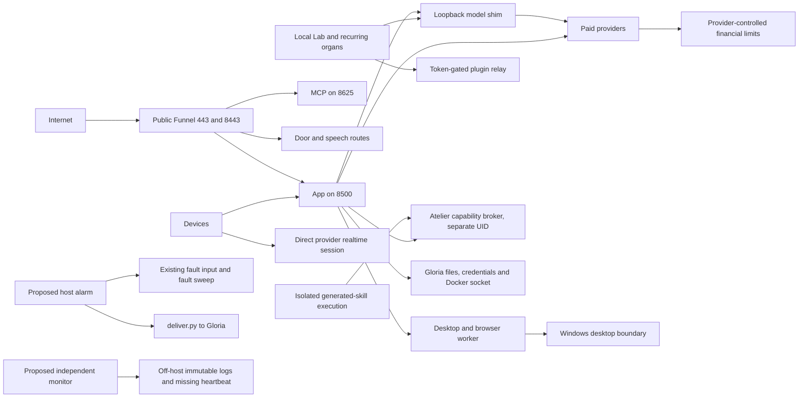

# Vintos security threat model

22 October 2026. Based on the verified Aegis snapshot in `security-audit.md`; proposed controls are not installed by this work.

## Assets and security goals

Protect Gloria's accounts, financial capacity, personal messages/files, authenticated device control, Vintos's durable identity/work/state, scientific results, and service availability. Preserve his intentional persistence, initiative, recurring work, chosen models, foreground responsiveness and legitimate tool use. Preserve Atelier's seals and owner exclusion: the owner does not acquire a new content-reading capability through this audit, monitoring or backups.

A cap should bound a resource or an identity's effects, not eliminate an organ. Untrusted text may suggest work; it may not change identity, spending authority, tool scopes or production administration.

## Actors

| Actor | Established capability | Boundary to preserve |
|---|---|---|
| Internet client | Can address configured Funnel listeners; public reachability outside the host was not scanned | Must not read private state, mint sessions, invoke devices or exhaust global capacity |
| Malicious web/document/Slack/tool content | Can appear in an ordinary workflow or connected response | Data stays data; possession of text is never approval to send, install, spend or administer |
| Compromised app/device credential | Shared app credential currently authorizes multiple surfaces; source default is accepted | Limit by audience, action, device and lifetime; preserve immediate hardware stop |
| Compromised local Gloria-owned service | Same UID as many other components; writable Docker socket | Must not gain unrelated keys, administrator operations, other stores or monitor state |
| Compromised experimental worker | May run generated code or scientific tools | Scratch filesystem, bounded CPU/GPU/RAM/time, no production credentials, admitted network only |
| Compromised host/root | Can forge local logs, baselines and process state | Only independent provider controls, external receiver and separately held backups remain trustworthy |
| Runaway legitimate process | Can repeat calls, enqueue tasks, retry failures or fill logs without malicious intent | Attempt rate, currency budgets, work leases, queue depth, disk retention and bounded concurrency |
| Builder/dependency compromise | Can alter installed code or downloaded remote model/plugin execution | Reviewed source, locked dependency identity, verified artifacts, bounded deployment authority |

## Trust boundaries and current evidence

1. **Internet → Funnel → app.** Loopback proxy origin is not user identity. The app is exposed by configuration, accepts the source-default shared credential, accepts anonymous telemetry WS, and has an anonymous voice-token handler. CORS does not authenticate a caller; changing browser origins alone will not fix this.
2. **App → provider credentials.** Several transports bypass shared reservations. A reservation is not a network attempt and is not a dollar cap. New accounting uses the existing compute ledger; the proposed pause is cooperative containment, not a root-proof network boundary.
3. **Aegis token mint → direct client realtime session.** Provider tokens can outlive an Aegis pause. Aegis cannot count subsequent requests it does not transport. Require authenticated bounded session minting and provider-side enforcement.
4. **Data → planning → tool effects.** Webpage/Slack/document/tool text must not furnish authority receipts. Existing effect gates, tool policies and Forge isolation are valuable. Concrete adapter identity and caller/target/task binding still require isolated tests per pathway. No prompt-injection exploit was run against production.
5. **Gloria UID → secrets/production/administration.** File mode 0600 does not isolate processes with the same UID. The writable Docker socket is a major escalation boundary. Desktop children currently inherit the parent's environment in source.
6. **Forge/Atelier → house.** The broker's separate identity and sealed export gates are intentional. New monitoring records code/config identity only and never hashes/reads sealed artifacts. Compartmentalization must not grant Gloria Atelier content access or move experimental writes into the production tree.
7. **Deployment → runtime.** Current server and router source copies were verified equal to the checkout; not all names guessed under `.vintos/bin` exist. The actual server is `~/Vintos/server.py`, and the shim runs from the checkout. A local deployment receipt is useful integrity evidence, not an independently signed attestation.
8. **Host → security evidence.** Same-account alarms and local backups cannot survive arbitrary root or account compromise. The proposed host alarm supplements fault response; provider billing and an off-host receiver form separate control planes.

## High-risk scenarios

| Scenario | Preconditions and consequence | Proposed containment |
|---|---|---|
| Default-credential takeover | Source-default accepted by public app; private/control routes impersonated | Coordinated credential replacement, no default fallback, per-audience scopes |
| Realtime spend/context theft | Anonymous mint route; session capability and instructions returned | Authenticate before any work; mint/session budgets; provider caps; session revocation |
| WS connection flood | Anonymous accept, no observed connection quota | WS tickets, per-device/global caps, bounded fanout, idle/connection lifetime and cleanup |
| Error/retry spending storm | Completion logs miss failures, reservation not per attempt | Count transport attempts, hourly provider alarms, manual shared pause, provider account limits |
| Injected desktop task | External text reaches a worker with broad environment and desktop reach | Task-bound permissions, clean env, separate browser profile/OS account, scoped effect adapters |
| Local service becomes administrator | Shared UID can write Docker socket | Dedicated identities, narrow broker for approved actions, approved Docker access review |
| Quiet persistence | SSH key, unit, cron or code changed; no independent watcher | Host change alarm, root-owned collector, off-host digest/event logs and missing heartbeat |
| Ransomware or disk loss | Production and local rollback copies share host/control | Encrypted immutable off-host state backup, separate credentials, isolated restore drill |
| Malicious model/plugin update | Remote code or plugin/dependency changes without pinned identity | Locked revision/hash, provenance review and sandbox; no automatic major updates |

## Residual risk and verification limits

No design makes a root-compromised host a trustworthy monitor of itself. Provider administrators and the external receiver must remain outside Vintos's credentials. Financial limits can have billing/concurrency delay and provider-specific scope; alerts alone do not stop charges.

Windows/Mac services, full tailnet ACLs, root SSH/firewall/spool state, all connected-app scopes and clean-host recovery remain outside the evidence obtained. A service declaring a sandbox in source is not proof its running instance enforces it. The alarm's first host snapshot is a baseline, not retrospective attestation; unfamiliar SSH addresses require Gloria's explicit allowlist, not automatic promotion from old logins.
